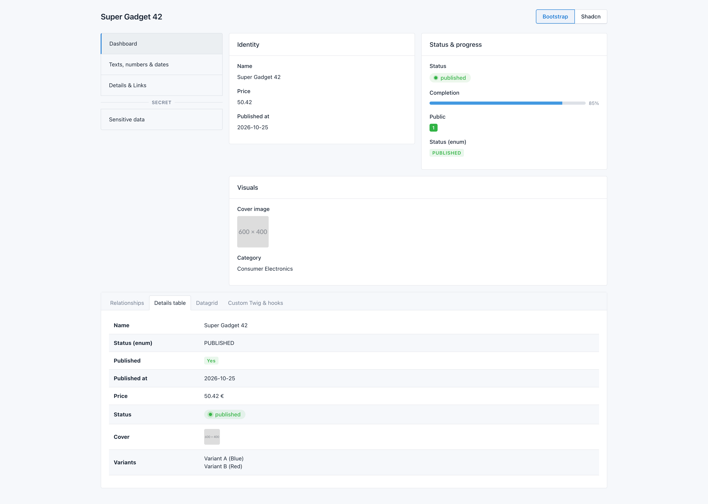
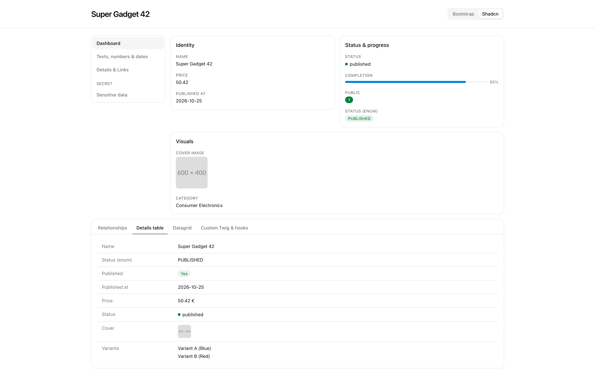

# rem42/sylius-ui-show-bundle

[](https://github.com/rem42/sylius-ui-show-bundle/actions/workflows/build.yml)
[](https://packagist.org/packages/rem42/sylius-ui-show-bundle)

**Configuration-driven "show" pages for the [Sylius Stack](https://github.com/Sylius/Stack) and any Symfony application.**

The Sylius Grid describes *index* pages in PHP; this bundle does the same for *show* pages. Describe tabs, cards,
columns and fields in a PHP class, and get it rendered with the markup of your admin UI (`bootstrap` theme for
`sylius/bootstrap-admin-ui`, `shadcn` theme for `rem42/shadcn-admin-ui`), automatically on your Sylius Admin UI show
pages through Twig Hooks.

## Features

- **`#[AsShow]` attribute**: invokable show definitions, just like `#[AsGrid]`.
- **Sylius Stack integration**: rendered automatically in the `sylius_admin.common.show.content` Twig Hook, configurable per resource.
- **Layouts**: sections, responsive columns, cards, tabs, side navigation, details tables, datagrids, custom templates, Twig Hooks.
- **16 field types**: string, number, boolean, datetime, enum, association, collection (table), badge, status, progress, image, icon, URL, file, sensitive, twig.
- **Field guessing**: `->add('name', 'createdAt', 'category')` guesses types from Doctrine, PHP types and naming conventions.
- **Extensible**: one template per element type, custom element types, custom guessers, `ShowBuildEvent`, decoratable services.

## Installation

```bash
composer require rem42/sylius-ui-show-bundle
```

```php
// config/bundles.php (without Symfony Flex)
Rem42\SyliusUiShow\Symfony\Rem42SyliusUiShowBundle::class => ['all' => true],
```

## Quick start

```php
namespace App\Show;

use App\Entity\Book;
use Rem42\SyliusUiShow\Attribute\AsShow;
use Rem42\SyliusUiShow\Builder\ShowBuilder;
use Rem42\SyliusUiShow\Model\Field\EnumField;
use Rem42\SyliusUiShow\Model\Field\StringField;
use Rem42\SyliusUiShow\Model\Layout\Card;
use Rem42\SyliusUiShow\Model\Layout\Column;
use Rem42\SyliusUiShow\Model\Layout\Section;

#[AsShow(resourceClass: Book::class)]
final class BookShow
{
    public function __invoke(ShowBuilder $show, Book $book): void
    {
        $show->withChildren(
            Section::create('main')->withChildren(
                Column::create(8)->withChildren(
                    Card::create('general')
                        ->withChildren(StringField::create('description')->setMultiline())
                        ->add('title', 'author', 'publishedAt'),   // types guessed
                ),
                Column::create(4)->withChildren(
                    Card::create('status')->withChildren(
                        EnumField::create('state')->setBadge(['published' => 'success', 'draft' => 'secondary']),
                    ),
                ),
            ),
        );
    }
}
```

**With the Sylius Stack**, add a `new Show()` operation to your resource: the show is rendered on its admin show page.

**Anywhere else**, render it in Twig:

```twig
{{ rem42_sylius_ui_show(book) }}
```

## Documentation

📖 **[Read the documentation](docs/README.md)**

* [Getting started](docs/getting-started.md)
* [Show definitions](docs/show-definitions.md) · [Layout elements](docs/layouts.md) · [Fields](docs/fields.md) · [Field guessing](docs/field-guessing.md)
* [Admin UI & Twig Hooks integration](docs/sylius-stack.md)
* [Templates, labels & events](docs/customization.md)
* [Twig reference](docs/reference/twig.md) · [Configuration reference](docs/reference/configuration.md)

## Screenshots

<a href="docs/screenshots/bootstrap.png" target="_blank">
    
</a>

<a href="docs/screenshots/shadcn.png" target="_blank">
    
</a>

## Development

```bash
make install   # composer install
make ci        # ECS + PHPStan (level max) + PHPUnit
make up        # demo application showcasing every element, in both themes:
               # http://localhost:8080/admin/show/product/1 (bootstrap)
               # http://localhost:8080/shadcn/admin/show/product/1 (shadcn)
```

The demo application lives in `tests/Application` (`App\Show\ProductShow` is a good tour of the API). Each theme runs
in its own kernel (`App\Kernel`): bundles flagged with its name in `config/bundles.php`, configuration of
`config/packages/{theme}/` and templates of `templates/themes/{theme}/`. The shadcn theme needs its assets:
`make assets` (Tailwind CSS build and importmap).

## License

This bundle is released under the [MIT License](LICENSE).
